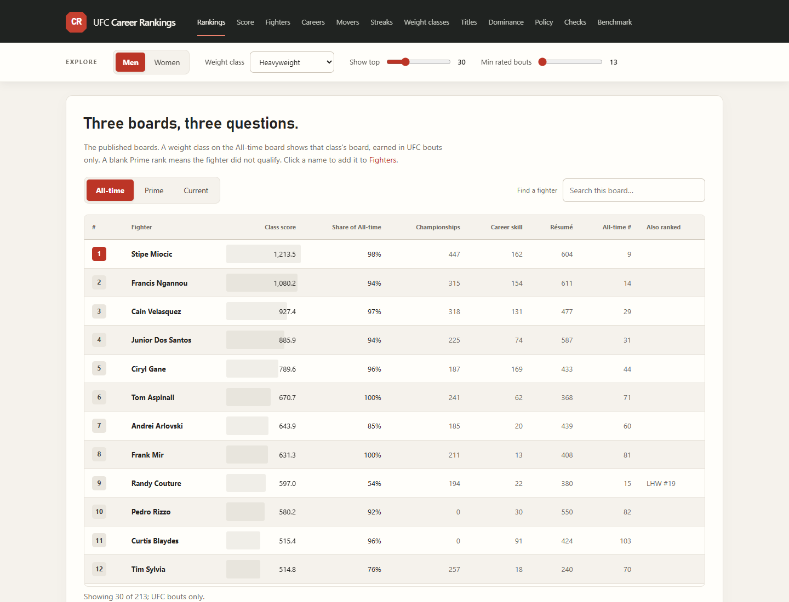
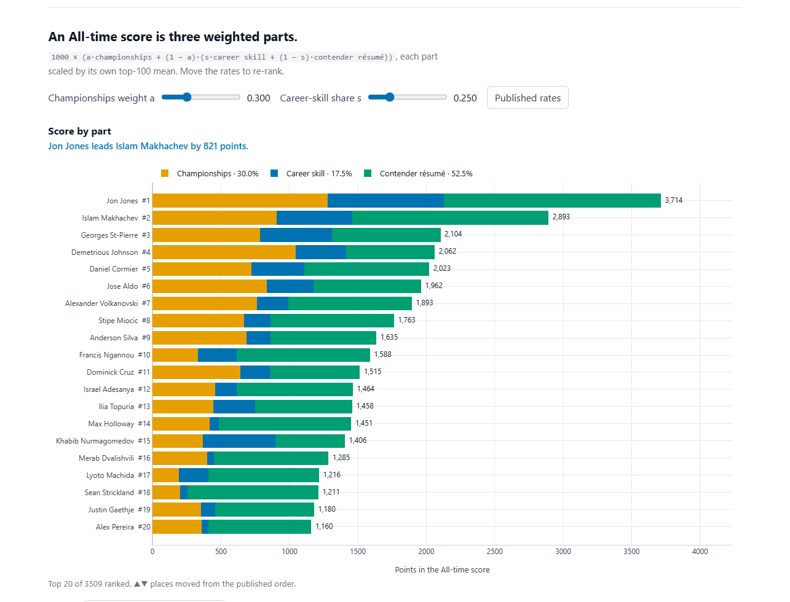
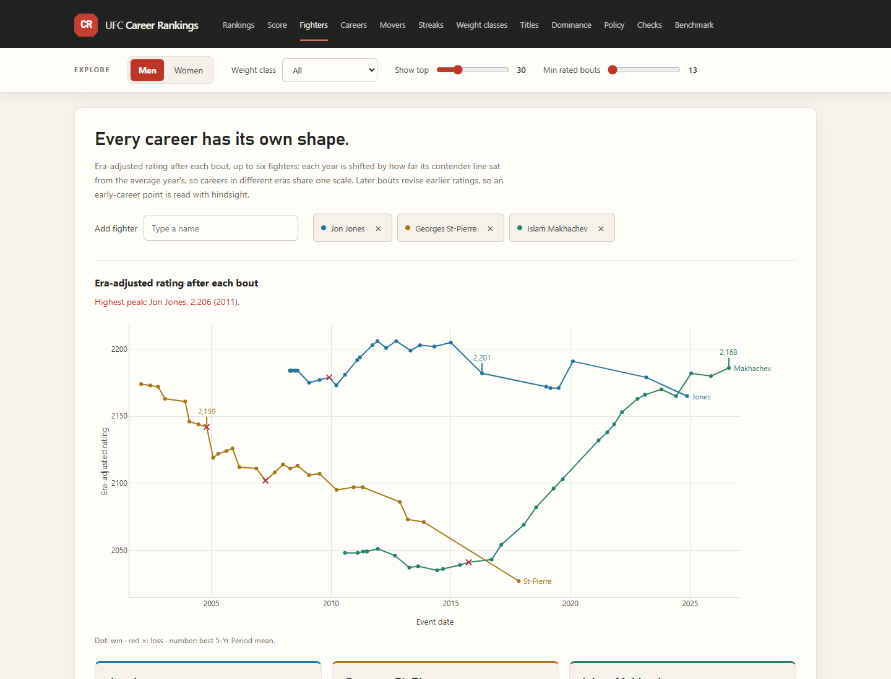
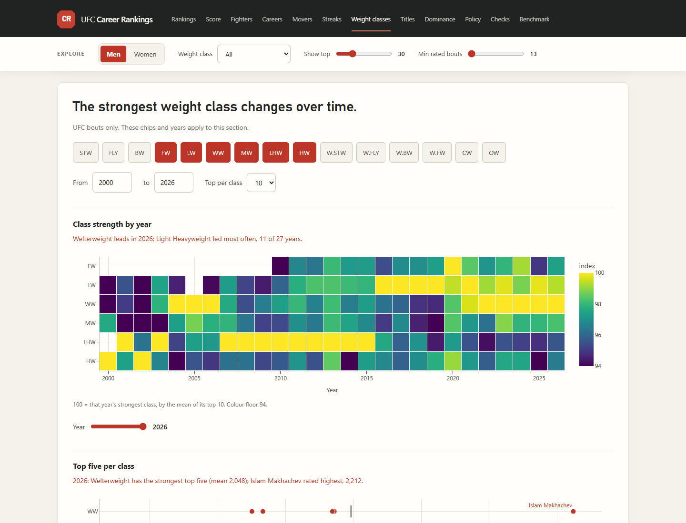

# MMA Career Rankings

<p align="center">
  <a href="https://symonyeal.github.io/MMA-Career-Rankings/"></a>
</p>

<p align="center"><b><a href="https://symonyeal.github.io/MMA-Career-Rankings/">symonyeal.github.io/UFC-Career-Rankings</a></b>
· every ranking and analysis in the browser, no install</p>

[](https://symonyeal.github.io/MMA-Career-Rankings/)

## In plain terms

Who is the greatest mixed martial artist? The answer depends on the question, so this
project answers three: the best career of all time, the best fighter at their peak, and the
best fighter right now. Men and women are ranked separately.

These are MMA rankings, not UFC-only rankings. Every recorded professional MMA fight (over
81,000 fights between 34,000 fighters, from every promotion and the regional circuit) goes
into one rating model. The All-time and Prime boards rank careers from the UFC and the
other major promotions (PRIDE, WEC, Strikeforce, Affliction, Bellator, RIZIN), which is why
Fedor Emelianenko ranks eleventh without a UFC fight. The Current board and the weight-class
boards are UFC only, because those are the divisions and title lines a "right now" ranking
has to follow.

By this measure Jon Jones ranks first for both career and peak, and Georges St-Pierre
second on both. Islam Makhachev is third for career and Anderson Silva third at peak. On the site you can change how
much each part of the score counts and watch the order change.

The site above is the way to read the answers. One set of controls (men or women, weight
class, how many fighters, minimum rated bouts) drives every section. The rest of this page
gives the exact rules.

## The math, in plain terms

| Method | What it does | Why this one |
| --- | --- | --- |
| **Whole-History Rating** (Coulom, 2008) | A chess-style rating: the gap between two ratings gives each fighter's chance of winning. It fits every career at once instead of one fight at a time. | A one-pass rating like Elo never goes back. If an opponent you beat later becomes a champion, that win should count for more, and here it does. Fitting all careers together also keeps fighters from different decades on one scale. |
| **A neutral starting bout** | Every fighter starts with the weight of one imaginary fight against an average opponent, half won and half lost. | Without it, a fighter at 2-0 has no upper limit and can top the board. With it, an unbeaten record has to keep growing against real opposition to climb. |
| **Graded results** | A finish counts as a full win; decisions and disqualifications count for slightly less, and a draw counts as half. | A knockout says more about who was better than a split decision does. |
| **A contender line for each year** | Every rating is read against its division's fifth-best fighter that year. | The rating scale drifts upward over time. Measuring against that year's contenders compares a 2007 win and a 2023 win fairly. |
| **Win probability raised to a power** | A win is valued by the chance the beaten opponent would have beaten a contender, raised to the fourth power for a title win and the third power for any other win over a contender. | One win over an elite contender is worth about five wins over borderline ones, so a long run of borderline wins cannot outscore a few elite ones. A higher power let a single win carry too much of a career; the third power was chosen after testing powers from 1 to 6. |
| **Promotion weights, pulled toward average** | The rating never looks at the promotion. Afterwards, a career's skill and contender-win points are scaled by where it was fought, between 0.20 and 1.00 (the UFC is 1.00), and a career with few promotion-labelled fights is pulled toward the average. | Keeping promotion out of the rating lets results decide how strong each pool was. The weight then accounts for depth of competition, and pulling thin evidence toward the average stops a handful of labelled fights from deciding a whole career. |
| **Square roots on a common scale** | The three parts (titles, contender wins, skill) are each measured against their top-100 average, square-rooted, then weighted. | It puts the three parts on one scale and rewards a career that is strong in all three more than one huge number in a single part. |
| **Best ten-year window** | Prime looks for the ten-year stretch with the most wins over contenders, and needs at least four. Each win beyond that adds to the score. | It measures a peak without punishing a fighter for a long career before or after it. |

The model has not yet been shown to predict fights better than a simpler rating; that test
is recorded as open in the [release check](docs/RELEASE_CHECK.md). The rankings are a
measured judgement of careers, not a betting model.

## What the site does

| Feature | What you can do |
| --- | --- |
| [**Rankings**](https://symonyeal.github.io/MMA-Career-Rankings/#rankings) | All-time, Prime and Current, exactly as published below. Pick a weight class for that class's own board: the All-time score earned in UFC bouts in that class. |
| [**Weight-class boards**](https://symonyeal.github.io/MMA-Career-Rankings/#rankings) | UFC only. A champion in two classes is ranked in both, with the share of their All-time score earned in each. |
| [**Score anatomy**](https://symonyeal.github.io/MMA-Career-Rankings/#anatomy) | See each score split into championships, career skill and contender résumé. Move two sliders to change the exchange rate and watch the board re-rank. |
| [**The math, in plain terms**](https://symonyeal.github.io/MMA-Career-Rankings/#math) | Each method behind the rankings, what it does and why it was chosen, in ordinary words. |
| [**Rank robustness**](https://symonyeal.github.io/MMA-Career-Rankings/#anatomy) | A heat map of one fighter's rank under every exchange rate, with the published choice marked. |
| [**Career arcs and tale of the tape**](https://symonyeal.github.io/MMA-Career-Rankings/#fighters) | Overlay up to six fighters' ratings fight by fight and compare their records, ranks and class placements side by side. |
| [**Where a career score comes from**](https://symonyeal.github.io/MMA-Career-Rankings/#careers) | A year-by-year receipt that sums to the career score, and how the order holds when every year's bar is raised. |
| [**Risers, fallers and streaks**](https://symonyeal.github.io/MMA-Career-Rankings/#movers) | The biggest rating moves of any year, and the longest UFC win streaks placed by length and by the strength of who they beat. |
| [**Weight classes and eras**](https://symonyeal.github.io/MMA-Career-Rankings/#divisions) | UFC only: how strong each class has been year by year, its top five in any year, and how fights end. |
| [**Title lineage**](https://symonyeal.github.io/MMA-Career-Rankings/#lineage) | Every reign in every class, with defences. |
| [**Integrity policy and outside check**](https://symonyeal.github.io/MMA-Career-Rankings/#policy) | The PED, disqualification and missed-weight ledger, and where the board disagrees with FightMatrix. |
| [**Forecast calibration**](https://symonyeal.github.io/MMA-Career-Rankings/#checks) | How often pre-fight favourites actually won, against the probability they were given, with 95% intervals. |

Each chart includes a finding calculated from the data under the current controls.
The page follows the reader's light or dark setting.

On a phone, open **Explore the rankings** to change the filters. Wide tables scroll
inside their panels. Weight-class buttons work with a keyboard, and the page follows
the reader's reduced-motion setting.

To check the interface locally, run `npm ci`, `npx playwright install chromium`, then
`npm test`. The browser checks cover search positions, roster filters, fighter
comparisons, analysis charts, phone layouts and dark mode. They also run in CI.

| Weight-class board | Score anatomy and exchange rates |
| --- | --- |
| [](https://symonyeal.github.io/MMA-Career-Rankings/#rankings) | [](https://symonyeal.github.io/MMA-Career-Rankings/#anatomy) |
| **Career arcs and tale of the tape** | **Weight classes over time** |
| [](https://symonyeal.github.io/MMA-Career-Rankings/#fighters) | [](https://symonyeal.github.io/MMA-Career-Rankings/#divisions) |

## The argument

Weight classes are separate pools. Career division is where a fighter competed
most; current division changes only after a UFC title win. Each year is measured
against its division's top ten percent, roughly the fifth-best fighter; classes
with fewer than 30 fighter-years use the sport-wide line. Men and women remain
separate.

The fight rating ignores promotion. Exposure is applied later: UFC is `1.00`,
PRIDE `0.95`, Affliction `0.90`, WEC and Strikeforce `0.88`, Bellator `0.65`, and
PFL, RIZIN, ONE and DREAM `0.60`. Thin evidence shrinks toward the average.

A knockout or submission scores `1.00`, a unanimous decision `0.95`, a split or
majority decision `0.90`, a disqualification `0.85`, and a draw `0.50` for each
fighter; no-contests are excluded. Careers are fitted together, so later results
can revalue earlier fights. Ratings sit around 1,500, and a neutral virtual bout
checks tiny unbeaten records. Duplicate fights are removed and whole careers
are required.

## What the score measures

```text
All-time = 1,000 × (30% √title + 17.5% √skill + 52.5% √résumé)
```

Each part is divided by the average of its own top 100, then square-rooted, before
weighting. A part of 1.0 still means "as much as a typical top-100 career", but
doubling a part adds only about 41%, so a career is paid for breadth across the
three parts more than for an extreme in one.

| Part | Weight | What it measures | Exact rule |
| --- | ---: | --- | --- |
| Title | 30% | Title fights won, valued by who was beaten | Each title win is worth `q⁴`, where `q` is the chance the opponent beats a contender-level fighter, using the opponent's rating going in against that division's contender level that year. A major-promotion title win is worth at least `0.05`. |
| Résumé | 52.5% | Wins over contenders, valued by how strong they were | Counts a win over an opponent rated at least 1,750 going in, with eight or more UFC bouts. Each is worth `q³` against 1,750: `0.13` just over the line, `0.26` at 100 points above, `0.61` at 300 above. At most `1.0` per calendar year. |
| Skill | 17.5% | How far the fighter's own rating stood above contender level | For every year with a fight: the fighter's average rating that year minus the division's contender level that year (about its fifth-best fighter). Years below the line add almost nothing; years above add the excess. Summed over the career. |

The rating behind all three is one model of every recorded fight, so beating a
fighter counts more the better that fighter proved to be. Skill and résumé are
then multiplied by the promotion exposure above, between 0.20 and 1.00. An
opponent returning from a long absence is marked down 90 points per excess
layoff, up to four. Because `q³` rises steeply, one win over an opponent 300
points above the line is worth about five wins over borderline contenders.

All-time and Prime read every rating against its own year's contender line. The
model's scale drifts upward over time: on this fit the 60th-best man stood at
1,834 in 2007 and 1,919 in 2023, so without this era adjustment a 2023 win
would be priced on a scale about 85 points higher than a 2007 win. Current,
whose fighters are all contemporaries, reads the unadjusted ratings.

**The score is a points total, not a ratio.** Jon Jones's 1,814 against Georges
St-Pierre's 1,564 does not mean Jones was 16% better. It means his three parts
add up to more points: title 617 against 482, résumé 812 against 777, skill 385
against 304. Most of the résumé gap is two elite wins: Daniel Cormier at 334
points above the line and Ciryl Gane at 261, where St-Pierre's best was Sean
Sherk at 189. For who was better at their best, read Prime: 2,193 against
2,110, an 83-point edge, which the rating turns into about a 62% chance of
winning.

Prime takes the ten-year stretch with the most wins over contenders, using the
same contender rule as the résumé, and needs four. It ranks by those wins times
the stretch's average rating above the lowest qualifying average. Current uses
the All-time formula over the last 18 months: title wins and contender wins in
that window, plus the latest rating above 1,750, capped at the best opponent the
fighter has ever beaten so an unbeaten run against weak opposition cannot keep
climbing. It needs 13 rated appearances, eight UFC bouts and a UFC bout within
18 months. Integrity deductions never alter a published board.

Each weight class has its own board, and it is UFC only: the All-time score counted
only from the title wins, contender wins and career years earned in UFC bouts in
that class. All-time and Prime count every promotion; the class boards and Current
count the UFC. What a fighter earned outside the UFC stays in their All-time score
but in no class, so their class scores add up to their All-time score less that
remainder. A champion in two classes is ranked in both.

## What is published

The men's headline boards are published below so the rankings are visible on
the repository front page. The full [Published MMA Rankings](RANKINGS.md) adds
the three women's boards and the weight-class boards.

<!-- PUBLICATION:RELEASE:BEGIN -->

| Release fact | Value |
| --- | ---: |
| Dataset | 2026-10-24 |
| Data through | 2026-10-24 |
| Included records | UFC, early UFC and major-promotion careers |
| All-time basis | All-time career score |
| Rated fights | 81,643 |
| Rated fighters | 34,150 |
| Available fight records | 83,053 |
| Whole-career coverage | 1,827 of 1,840 eligible fighters (99.3%) |
| Prime contender threshold | 1,750 — reached by 25.3% of established fighters |
| Prime qualifiers | 102 men; 7 women |

<!-- PUBLICATION:RELEASE:END -->

### All-time — men, top 100

**Prime** and **Prime rank** come from the Prime board below, and **Elite
wins** is the evidence behind that rank. A blank rank means the fighter did not
qualify, not that they placed last.

<!-- BOARD:TOP100:BEGIN -->

| # | Fighter | Division | Score | Prime | Prime rank | Elite wins |
| ---: | --- | --- | ---: | ---: | ---: | ---: |
| 1 | Jon Jones | Light Heavyweight | 1813.7 | 2193 | 1 | 11 |
| 2 | Georges St-Pierre | Welterweight | 1563.5 | 2110 | 2 | 12 |
| 3 | Islam Makhachev | Lightweight | 1559.8 | 2157 | 4 | 8 |
| 4 | Alexander Volkanovski | Featherweight | 1406.2 | 2032 | 6 | 10 |
| 5 | Anderson Silva | Middleweight | 1384.4 | 1955 | 3 | 14 |
| 6 | Jose Aldo | Featherweight | 1364.0 | 1915 | 12 | 9 |
| 7 | Daniel Cormier | Light Heavyweight | 1348.0 | 2055 | 7 | 8 |
| 8 | Demetrious Johnson | Flyweight | 1328.9 | 1951 | 41 | 5 |
| 9 | Stipe Miocic | Heavyweight | 1214.4 | 1951 | 24 | 6 |
| 10 | Dominick Cruz | Bantamweight | 1208.4 | 1933 | 45 | 5 |
| 11 | Fedor Emelianenko | Heavyweight | 1193.0 | 2085 | 5 | 9 |
| 12 | Matt Hughes | Welterweight | 1142.0 | 1976 | 56 | 4 |
| 13 | Lyoto Machida | Light Heavyweight | 1132.9 | 2011 | 11 | 7 |
| 14 | Francis Ngannou | Heavyweight | 1131.8 | 1994 | 19 | 6 |
| 15 | Ilia Topuria | Featherweight | 1103.8 | 2081 | 27 | 4 |
| 16 | Randy Couture | Heavyweight | 1096.3 | 1879 | 16 | 9 |
| 17 | Max Holloway | Featherweight | 1072.8 | 1924 | 10 | 9 |
| 18 | Khabib Nurmagomedov | Lightweight | 1072.4 | 2132 | 22 | 4 |
| 19 | BJ Penn | Lightweight | 1053.1 | 1888 | 14 | 9 |
| 20 | Chuck Liddell | Light Heavyweight | 1046.5 | 1883 | 15 | 9 |
| 21 | Israel Adesanya | Middleweight | 1044.5 | 1879 | 28 | 7 |
| 22 | Tito Ortiz | Light Heavyweight | 1029.6 | 1869 | 50 | 6 |
| 23 | Benson Henderson | Lightweight | 1004.9 | 1852 | 43 | 7 |
| 24 | Dan Henderson | Middleweight | 998.3 | 1946 | 18 | 7 |
| 25 | Frankie Edgar | Lightweight | 992.1 | 1911 | 9 | 10 |
| 26 | Justin Gaethje | Lightweight | 970.0 | 1952 | 39 | 5 |
| 27 | Cain Velasquez | Heavyweight | 970.0 | 1963 | 21 | 6 |
| 28 | Antonio Rodrigo Nogueira | Heavyweight | 963.2 | 2041 | 8 | 7 |
| 29 | Mauricio Rua | Light Heavyweight | 953.4 | 1854 | 40 | 7 |
| 30 | Merab Dvalishvili | Bantamweight | 938.9 | 1910 | 33 | 6 |
| 31 | Aljamain Sterling | Bantamweight | 938.0 | 1899 | 57 | 5 |
| 32 | Petr Yan | Bantamweight | 936.2 | 1923 | 65 | 4 |
| 33 | Alex Pereira | Light Heavyweight | 935.5 | 1920 | 31 | 6 |
| 34 | Junior Dos Santos | Heavyweight | 934.6 | 1909 | 34 | 6 |
| 35 | Sean Strickland | Middleweight | 930.9 | 1876 | 20 | 8 |
| 36 | Dricus Du Plessis | Middleweight | 926.1 | 2002 | 17 | 6 |
| 37 | Chris Weidman | Middleweight | 906.0 | 1854 | 42 | 7 |
| 38 | Wanderlei Silva | Light Heavyweight | 890.3 | 1892 | 70 | 4 |
| 39 | Charles Oliveira | Lightweight | 878.9 | 1937 | 25 | 6 |
| 40 | Kamaru Usman | Welterweight | 874.9 | 1923 | 29 | 6 |
| 41 | Khamzat Chimaev | Middleweight | 847.6 | 2045 | 38 | 4 |
| 42 | Vitor Belfort | Middleweight | 846.0 | 1812 | 71 | 5 |
| 43 | Ciryl Gane | Heavyweight | 839.0 | 2014 | 44 | 4 |
| 44 | Sean Sherk | Lightweight | 839.0 | 1984 | 13 | 7 |
| 45 | Henry Cejudo | Flyweight | 835.4 | 1835 | 76 | 4 |
| 46 | Patricio Freire | Featherweight | 823.4 | 1907 |  | 3 |
| 47 | Rashad Evans | Light Heavyweight | 818.1 | 1873 | 32 | 7 |
| 48 | Anthony Pettis | Lightweight | 815.6 | 1756 | 84 | 5 |
| 49 | Gegard Mousasi | Middleweight | 814.6 | 1918 | 52 | 5 |
| 50 | Dustin Poirier | Lightweight | 813.7 | 1896 | 69 | 4 |
| 51 | Ryan Bader | Light Heavyweight | 810.9 | 1905 | 55 | 5 |
| 52 | Fabricio Werdum | Heavyweight | 809.9 | 1907 | 36 | 6 |
| 53 | Rich Franklin | Middleweight | 807.0 | 1909 | 35 | 6 |
| 54 | Vadim Nemkov | Light Heavyweight | 805.5 | 2023 | 23 | 5 |
| 55 | Conor McGregor | Featherweight | 804.6 | 1806 | 83 | 4 |
| 56 | Mark Coleman | Heavyweight | 797.0 | 1873 |  | 3 |
| 57 | Mirko Filipovic | Heavyweight | 791.0 | 1865 | 63 | 5 |
| 58 | Quinton Jackson | Light Heavyweight | 781.7 | 1873 | 61 | 5 |
| 59 | Sean O'Malley | Bantamweight | 753.8 | 1912 | 66 | 4 |
| 60 | Josh Barnett | Heavyweight | 752.6 | 1994 | 53 | 4 |
| 61 | Eddie Alvarez | Lightweight | 746.3 | 1725 | 95 | 4 |
| 62 | Andrei Arlovski | Heavyweight | 745.6 | 1811 | 72 | 5 |
| 63 | Joshua Van | Flyweight | 740.8 | 1946 |  | 3 |
| 64 | Luke Rockhold | Middleweight | 731.1 | 1841 | 67 | 5 |
| 65 | Jake Shields | Welterweight | 722.9 | 1833 | 37 | 8 |
| 66 | Phil Davis | Light Heavyweight | 720.0 | 1935 | 62 | 4 |
| 67 | Matt Serra | Welterweight | 711.4 | 1766 |  | 3 |
| 68 | Jens Pulver | Lightweight | 704.1 | 1715 | 93 | 5 |
| 69 | Forrest Griffin | Light Heavyweight | 686.9 | 1850 | 58 | 6 |
| 70 | Tim Sylvia | Heavyweight | 683.4 | 1856 |  | 3 |
| 71 | Deiveson Figueiredo | Flyweight | 678.0 | 1773 | 89 | 4 |
| 72 | Tyron Woodley | Welterweight | 676.4 | 1764 | 91 | 4 |
| 73 | Tom Aspinall | Heavyweight | 676.1 | 1893 |  | 3 |
| 74 | Robert Whittaker | Middleweight | 672.2 | 1842 | 59 | 6 |
| 75 | Carlos Condit | Welterweight | 666.1 | 1704 | 100 | 4 |
| 76 | Kevin Randleman | Heavyweight | 663.4 | 1704 | 99 | 4 |
| 77 | Rafael Dos Anjos | Lightweight | 660.5 | 1726 | 87 | 6 |
| 78 | Ricardo Arona |  | 653.2 | 1925 | 49 | 5 |
| 79 | Renan Barao | Bantamweight | 648.1 | 1617 |  | 3 |
| 80 | Demian Maia | Welterweight | 644.2 | 1847 | 26 | 8 |
| 81 | Urijah Faber | Bantamweight | 640.9 | 1799 |  | 3 |
| 82 | Frank Mir | Heavyweight | 637.2 | 1758 | 92 | 4 |
| 83 | Frank Shamrock | Light Heavyweight | 629.4 | 1781 |  | 2 |
| 84 | TJ Dillashaw | Bantamweight | 622.7 | 1804 |  | 3 |
| 85 | Jan Blachowicz | Light Heavyweight | 619.2 | 1752 |  | 3 |
| 86 | Leon Edwards | Welterweight | 617.4 | 1800 |  | 2 |
| 87 | Alexander Volkov | Heavyweight | 615.5 | 1879 | 46 | 6 |
| 88 | Kazushi Sakuraba | Welterweight | 614.1 | 1779 |  | 3 |
| 89 | Anthony Johnson | Light Heavyweight | 613.3 | 1921 | 30 | 6 |
| 90 | Pedro Rizzo | Heavyweight | 599.2 | 1834 | 77 | 4 |
| 91 | Robbie Lawler | Welterweight | 595.0 | 1671 |  | 3 |
| 92 | Diego Sanchez | Welterweight | 593.7 | 1807 | 82 | 4 |
| 93 | Rogerio Nogueira | Light Heavyweight | 585.5 | 1862 | 64 | 5 |
| 94 | Movsar Evloev | Featherweight | 583.0 | 1995 | 51 | 4 |
| 95 | Alistair Overeem | Heavyweight | 582.5 | 1781 | 88 | 4 |
| 96 | Mike Brown | Featherweight | 579.1 | 1683 |  | 2 |
| 97 | Jeremy Horn | Middleweight | 576.3 | 1875 | 48 | 6 |
| 98 | Johny Hendricks | Welterweight | 571.4 | 1777 | 79 | 5 |
| 99 | Johnny Eblen | Middleweight | 569.6 | 1993 |  | 2 |
| 100 | Magomed Ankalaev | Light Heavyweight | 566.6 | 1927 |  | 2 |

<!-- BOARD:TOP100:END -->

### Prime, elite-tested — men, top 50

The table prints both inputs instead of the internal ordering index.

<!-- BOARD:ELITEPRIME50:BEGIN -->

| # | Fighter | Division | Prime | Elite wins |
| ---: | --- | --- | ---: | ---: |
| 1 | Jon Jones | Light Heavyweight | 2193 | 11 |
| 2 | Georges St-Pierre | Welterweight | 2110 | 12 |
| 3 | Anderson Silva | Middleweight | 1955 | 14 |
| 4 | Islam Makhachev | Lightweight | 2157 | 8 |
| 5 | Fedor Emelianenko | Heavyweight | 2085 | 9 |
| 6 | Alexander Volkanovski | Featherweight | 2032 | 10 |
| 7 | Daniel Cormier | Light Heavyweight | 2055 | 8 |
| 8 | Antonio Rodrigo Nogueira | Heavyweight | 2041 | 7 |
| 9 | Frankie Edgar | Lightweight | 1911 | 10 |
| 10 | Max Holloway | Featherweight | 1924 | 9 |
| 11 | Lyoto Machida | Light Heavyweight | 2011 | 7 |
| 12 | Jose Aldo | Featherweight | 1915 | 9 |
| 13 | Sean Sherk | Lightweight | 1984 | 7 |
| 14 | BJ Penn | Lightweight | 1888 | 9 |
| 15 | Chuck Liddell | Light Heavyweight | 1883 | 9 |
| 16 | Randy Couture | Heavyweight | 1879 | 9 |
| 17 | Dricus Du Plessis | Middleweight | 2002 | 6 |
| 18 | Dan Henderson | Middleweight | 1946 | 7 |
| 19 | Francis Ngannou | Heavyweight | 1994 | 6 |
| 20 | Sean Strickland | Middleweight | 1876 | 8 |
| 21 | Cain Velasquez | Heavyweight | 1963 | 6 |
| 22 | Khabib Nurmagomedov | Lightweight | 2132 | 4 |
| 23 | Vadim Nemkov | Light Heavyweight | 2023 | 5 |
| 24 | Stipe Miocic | Heavyweight | 1951 | 6 |
| 25 | Charles Oliveira | Lightweight | 1937 | 6 |
| 26 | Demian Maia | Welterweight | 1847 | 8 |
| 27 | Ilia Topuria | Featherweight | 2081 | 4 |
| 28 | Israel Adesanya | Middleweight | 1879 | 7 |
| 29 | Kamaru Usman | Welterweight | 1923 | 6 |
| 30 | Anthony Johnson | Light Heavyweight | 1921 | 6 |
| 31 | Alex Pereira | Light Heavyweight | 1920 | 6 |
| 32 | Rashad Evans | Light Heavyweight | 1873 | 7 |
| 33 | Merab Dvalishvili | Bantamweight | 1910 | 6 |
| 34 | Junior Dos Santos | Heavyweight | 1909 | 6 |
| 35 | Rich Franklin | Middleweight | 1909 | 6 |
| 36 | Fabricio Werdum | Heavyweight | 1907 | 6 |
| 37 | Jake Shields | Welterweight | 1833 | 8 |
| 38 | Khamzat Chimaev | Middleweight | 2045 | 4 |
| 39 | Justin Gaethje | Lightweight | 1952 | 5 |
| 40 | Mauricio Rua | Light Heavyweight | 1854 | 7 |
| 41 | Demetrious Johnson | Flyweight | 1951 | 5 |
| 42 | Chris Weidman | Middleweight | 1854 | 7 |
| 43 | Benson Henderson | Lightweight | 1852 | 7 |
| 44 | Ciryl Gane | Heavyweight | 2014 | 4 |
| 45 | Dominick Cruz | Bantamweight | 1933 | 5 |
| 46 | Alexander Volkov | Heavyweight | 1879 | 6 |
| 47 | Curtis Blaydes | Heavyweight | 1877 | 6 |
| 48 | Jeremy Horn | Middleweight | 1875 | 6 |
| 49 | Ricardo Arona |  | 1925 | 5 |
| 50 | Tito Ortiz | Light Heavyweight | 1869 | 6 |

<!-- BOARD:ELITEPRIME50:END -->

### Current — men, top 30

<!-- BOARD:CURRENT30:BEGIN -->

| # | Fighter | Division | Score | Title wins | Contender wins | UFC bouts | Last UFC bout |
| ---: | --- | --- | ---: | ---: | ---: | ---: | ---: |
| 1 | Justin Gaethje | Lightweight | 1902 | 2 | 2 | 16 | 2026-06-14 |
| 2 | Islam Makhachev | Welterweight | 1847 | 2 | 2 | 19 | 2026-08-15 |
| 3 | Joshua Van | Flyweight | 1793 | 3 | 4 | 12 | 2026-09-19 |
| 4 | Alexander Volkanovski | Featherweight | 1735 | 2 | 2 | 19 | 2026-10-24 |
| 5 | Petr Yan | Bantamweight | 1721 | 2 | 2 | 17 | 2026-10-24 |
| 6 | Sean Strickland | Middleweight | 1610 | 1 | 2 | 25 | 2026-05-09 |
| 7 | Merab Dvalishvili | Bantamweight | 1455 | 2 | 2 | 18 | 2026-10-24 |
| 8 | Khamzat Chimaev | Middleweight | 1428 | 1 | 1 | 10 | 2026-05-09 |
| 9 | Ilia Topuria | Lightweight | 1359 | 1 | 1 | 10 | 2026-06-14 |
| 10 | Alex Pereira | Light Heavyweight | 1241 | 1 | 1 | 13 | 2026-06-14 |
| 11 | Ciryl Gane | Heavyweight | 1227 | 1 | 1 | 13 | 2026-06-14 |
| 12 | Carlos Ulberg | Light Heavyweight | 1221 | 1 | 2 | 11 | 2026-04-11 |
| 13 | Jack Della Maddalena | Welterweight | 1035 | 1 | 1 | 10 | 2026-05-02 |
| 14 | Charles Oliveira | Lightweight | 992 | 0 | 2 | 36 | 2026-03-07 |
| 15 | Ian Machado Garry | Welterweight | 918 | 0 | 2 | 12 | 2026-08-15 |
| 16 | Carlos Prates | Welterweight | 818 | 0 | 2 | 8 | 2026-05-02 |
| 17 | Sean O'Malley | Bantamweight | 813 | 0 | 2 | 15 | 2026-06-14 |
| 18 | Diego Lopes | Featherweight | 790 | 0 | 2 | 10 | 2026-06-14 |
| 19 | Manel Kape | Flyweight | 781 | 0 | 2 | 11 | 2026-06-20 |
| 20 | Nassourdine Imavov | Middleweight | 775 | 0 | 1 | 11 | 2025-09-06 |
| 21 | Alexander Volkov | Heavyweight | 767 | 0 | 2 | 20 | 2026-10-24 |
| 22 | Movsar Evloev | Featherweight | 757 | 0 | 1 | 11 | 2026-10-24 |
| 23 | Song Yadong | Bantamweight | 747 | 0 | 1 | 18 | 2026-08-29 |
| 24 | Umar Nurmagomedov | Bantamweight | 741 | 0 | 1 | 10 | 2026-08-29 |
| 25 | Gregory Rodrigues | Middleweight | 732 | 0 | 2 | 14 | 2026-08-22 |
| 26 | Brendan Allen | Middleweight | 713 | 0 | 2 | 20 | 2026-10-10 |
| 27 | Paulo Costa | Middleweight | 696 | 0 | 2 | 12 | 2026-04-11 |
| 28 | Max Holloway | Featherweight | 694 | 0 | 1 | 33 | 2026-07-11 |
| 29 | Aljamain Sterling | Bantamweight | 685 | 0 | 2 | 23 | 2026-04-25 |
| 30 | Gabriel Bonfim | Welterweight | 662 | 0 | 2 | 8 | 2026-06-06 |

<!-- BOARD:CURRENT30:END -->

## Where the numbers stop

All-time is retrospective, elite wins reward opportunity, and the age curve
misses decline in fighters who never returned. Promotion labels are missing from 54% of rated fights;
11% of filled weight classes are estimated wrong. Whole-career coverage is
complete for every eligible fighter, and none has an evidenced source-ID
conflict. See the [decision register](docs/DECISIONS.md).

## Project map

| Path | Use it for |
| --- | --- |
| [`RANKINGS.md`](RANKINGS.md) | Full rankings |
| `ratings/` / `loaders/` | Model / data assembly |
| `rust/whr_rs/` | The rating solver's inner loop in Rust; gives the same ratings as the Python version, bit for bit |
| `data/snapshots/<date>/` | The release: inputs, fitted ratings and boards, all versioned |
| [`docs/`](docs/) | Method and decisions |
| [`docs/RELEASE_CHECK.md`](docs/RELEASE_CHECK.md) | Source freshness, fresh-checkout reproduction and the limits of current predictive evidence |
| [`site/`](site/) | Interactive analysis site, published at <https://symonyeal.github.io/MMA-Career-Rankings/>; open `site/index.html` locally |
| `tests/` | Verification |

Use the system Python:

```text
python -m pip install -r requirements.txt
python -m pip install maturin ./rust/whr_rs
python -m pytest -q
python check_release.py
python build_boards.py data/snapshots/2026-10-24 --scope majors,pre_unified --write-readme
```

The second line needs a Rust toolchain ([rustup](https://rustup.rs)). It is optional: without it
the rating solver runs in Python. Tests require the two backends to give the same ratings bit for bit.

Refresh the narrative figures after rebuilding a release:
`python analysis/readme_figures.py --write-readme`. The tests check these figures against the data.

The site draws the notebook's analyses from one snapshot. Its data file, `site/data.js`, is
generated; rebuild it after the boards change:

```text
python analysis/build_site.py data/snapshots/2026-10-24
```

`index.html` loads each asset as `name?v=<content hash>`, so a browser never pairs the page with a
cached older asset. After editing `app.js` or `style.css` alone, re-stamp with
`python analysis/build_site.py --stamp`; a test fails while the stamp is stale.
